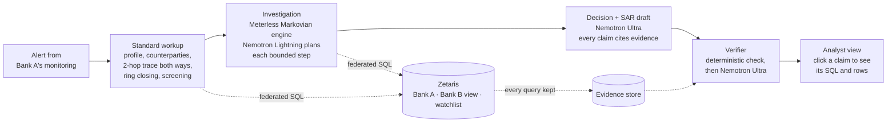

# Casefile

**An AML investigator that follows the money across banks, and shows you why it decided.**

Casefile takes a transaction-monitoring alert from one bank, follows the money into a second bank through **Zetaris** (federated SQL; the partner bank's personal data stays behind a governed view), tests innocent explanations with **NVIDIA Nemotron** served through **Meterless Nightshift**, and writes a suspicious-activity-report (SAR) draft in which **every claim cites the exact query and rows behind it**. A verifier rejects any claim its evidence does not support before an analyst reads it.

Open Agent Hackathon 2026 · Track 02: *The Agent That Can Explain Why*

> **Try it in one minute, no keys:** `pip install -r requirements.txt -r requirements-ui.txt`, then `SAMPLE_MODE=true streamlit run app.py`. Sample mode runs the whole agent on a bundled slice of the real data and replays the model answers recorded from a real run ([sample/README.md](sample/README.md)).

---

## The problem

Money laundering crosses bank boundaries on purpose. Each bank sees only its own side of a transfer, so money that leaves Bank A, passes through accounts at Bank B and comes back looks harmless from inside either bank. The UN puts laundering at 2 to 5% of global GDP each year ([AMLworld paper](https://arxiv.org/abs/2306.16424)), yet most monitoring alerts are false positives, and an analyst spends most of each one stitching systems together before writing up a decision that a reviewer has to take on trust.

**Who it is for:** AML analysts and their reviewers at banks that share data with partners under governance (consortia, correspondent banking, group entities in different jurisdictions).

## What Casefile does with one alert



1. **Standard workup** (deterministic, the same for every alert): the customer record; who the account paid and was paid by; a time-ordered trace two hops out and two hops back across both banks; a ring-closing query that looks for payments linking where the money went to where it came from; watchlist screening; and measured typology signals (cycles, layering, scatter-gather, pass-through, interconnected counterparties, uniform amounts, hubs).
2. **Investigation on the Meterless Markovian engine.** The planner reads the workup and asks its own questions (a payroll account? a merchant? the customer's own accounts? a hub?) by calling the same federated tools. Each step is a bounded chunk with a compact carryover state, so the prompt stays flat however long the investigation runs. It cannot repeat a call.
3. **Decision and SAR draft:** ESCALATE or CLOSE, the typology, confidence, the evidence against, what would change the decision, a separate sanctions referral, and what governance stopped it from checking.
4. **Verifier:** every claim must cite evidence that exists in this case; every account id, date and number in a factual claim must appear in that evidence; then Nemotron reads each claim next to its evidence. Rejected claims stay visible, struck through.
5. **Evidence standard:** the structure measured in the money decides the disposition. If the model leans the other way, the case is marked **NEEDS REVIEW** instead of either side silently winning.

The app shows each case in five tabs: **Findings** (claims with their verdicts, each opening its SQL and rows), **Money flow** (the pattern as a graph), **Investigation trace** (each Markovian step, its carryover and prompt size), **Evidence** (every query) and **SAR draft** (downloadable).

## How the sponsor technology is used

| | What it does in Casefile |
| --- | --- |
| **Zetaris** | The only path to data. Every tool is federated Spark SQL across Bank A's database, Bank B's database and a compliance store; `get_counterparties` joins both ledgers and both banks' customer records in one statement. Bank B shares customer records only through a view inside B's database that drops names, birth dates and ID numbers. Every query is kept with its SQL, rows and timing as evidence. |
| **Meterless Markovian engine** | Runs the investigation in bounded steps with a `COMPLETED / REMAINING / DECISIONS / CONTEXT` carryover, tool calls as `[NEEDS_TOOL]` markers, a compression cascade and a reflection pass (`casefile/markovian/`). **Meterless's own conformance runner passes 8/8 against it.** |
| **Meterless Nightshift** | The primary AI provider: every model call goes through it, following its provider contract (`meterless-app` and `meterless-scope` headers, token, status from `/v1/models`). `scripts/check_nightshift.py` checks it end to end. |
| **NVIDIA Nemotron** | Through Nightshift (the NVIDIA key lives in Nightshift, not in this project): `nemotron-3.5-lightning-30b-a3b` plans each investigation step; `nemotron-3-ultra-550b-a55b` writes the decision and verifies every claim. Reasoning is switched per step. |

Details, configuration and the tests that show each piece working: **[docs/SPONSORS.md](docs/SPONSORS.md)**.

## Results

Scored on 30 held-out alerts from IBM AMLworld (15 laundering, 15 hard negatives that trip the same rules), labels read only after each case. Thresholds and signals were tuned on a separate 64-alert batch. Before that batch existed, the model prompts were first calibrated on test alerts ALR-001 to ALR-005, so scores are also shown on the 25 alerts that were never looked at.

{{RESULTS_TABLE}}

- **Rules only** is Casefile's measured structure with no model: the deterministic baseline.
- **Bank A only** is the same agent with Institution B's data hidden: what Bank A could conclude alone.
- **Claims rejected** counts claims the verifier struck out. They stay visible in the report.

{{RESULTS_NOTES}}

Full logs, per-case results and every model call: {{RUN_LINKS}}.

## Where the data lives

| Data owner | What | Zetaris name |
| --- | --- | --- |
| Institution A (the analyst's bank) | Ledger | `inst_a.ledger_a` |
| Institution A | Customer records, complete | `inst_a.kyc_a` |
| Institution B (partner bank) | Ledger | `inst_b.ledger_b` |
| Institution B | Customer records **without names, birth dates or ID numbers** | `inst_b.kyc_b_shared` (a view inside B's database) |
| Compliance | Synthetic watchlist | `compliance.watchlist` |

Transactions come from IBM's **AMLworld** HI-Small (synthetic, with complete laundering labels; CDLA-Sharing-1.0). Customer records and the watchlist are generated. There are no real people anywhere. Source, licence, counts, registration and limitations: **[data/README.md](data/README.md)**.

---

## Setup

Python 3.10 or newer. Every command runs from the `casefile` folder.

```bash
python -m venv .venv
source .venv/bin/activate            # Windows: .venv\Scripts\activate
pip install -r requirements.txt -r requirements-ui.txt
cp .env.example .env                 # Windows: copy .env.example .env
```

### 1. Sample mode: no Zetaris, no Nightshift, no keys

```bash
SAMPLE_MODE=true streamlit run app.py                  # the analyst view
SAMPLE_MODE=true python scripts/run_eval.py            # score the sample alerts
```

(PowerShell: `$env:SAMPLE_MODE="true"` first. Or set `SAMPLE_MODE=true` in `.env`.) Everything runs for real except the model, whose answers come from `sample/recordings/`; see [sample/README.md](sample/README.md).

### 2. The full system

The full system needs Docker with about 8 GB of memory for Zetaris. The guided route runs it in a free GitHub Codespace, with Nightshift on your own computer:

1. **Codespace, data and Zetaris:** [docs/CODESPACE.md](docs/CODESPACE.md), 10 numbered steps. Data download, preparation, loading and Zetaris registration are all scripted (`get_data.sh`, `prepare_data.py`, `publish_local.py load`, `zetaris_apply.py`).
2. **Nightshift and NVIDIA:** [docs/NIGHTSHIFT.md](docs/NIGHTSHIFT.md). Install Nightshift on your computer, add your NVIDIA key inside it, open the one-line tunnel, then `python scripts/codespace/setup_env.py --nightshift` and `python scripts/check_nightshift.py`.
3. **Check and run:**

```bash
python scripts/check_setup.py                 # five tables through Zetaris and a federated three-way query
python scripts/investigate.py ALR-004         # one case end to end in the terminal
streamlit run app.py                          # the analyst view
```

On your own machine instead of a Codespace: install Docker Desktop, start Zetaris with its bundle from the [Run locally page](https://cloud.enterprise.zetaris.com/dashboard/download), then run the same scripts (`infra/docker-compose.sources.yml` starts the sources database; `ZETARIS_PG_HOST=host.docker.internal`).

### Settings

All settings live in `.env` (see `.env.example`; it is gitignored, and keys are never committed).

| Setting | Default | |
| --- | --- | --- |
| `SAMPLE_MODE` | `false` | bundled data and recorded answers |
| `CASEFILE_DATA_BACKEND` | `local` | `zetaris` for live federation; `local` is a DuckDB stand-in with the same table names |
| `CASEFILE_LLM_PROVIDER` | `meterless` | Nightshift; `nvidia` calls NVIDIA's API directly (development only) |
| `METERLESS_BASE_URL`, `METERLESS_TOKEN` | `http://127.0.0.1:8088/v1` | Nightshift's address and proxy token |
| `CASEFILE_MODEL_PLAN / REPORT / VERIFY` | Nemotron Lightning / Ultra / Ultra | any model id or Nightshift routing mode |
| `CASEFILE_THINKING_PLAN / REPORT / VERIFY` | `off` / `medium` / `medium` | Nemotron reasoning per step |
| `ZETARIS_ROUTE`, `ZETARIS_BASE_URL`, `ZETARIS_ORG_ID`, `ZETARIS_USERNAME`, `ZETARIS_PASSWORD` | | the Zetaris connection |

## Usage

| Command | What it does |
| --- | --- |
| `streamlit run app.py` | The analyst view: pick an alert, **Investigate**, open any claim |
| `python scripts/investigate.py ALR-004 [--rules] [--steps N]` | One case in the terminal; writes `runs/cases/<id>.json`, `.report.json`, `.sar.md` |
| `python scripts/run_eval.py [--rules] [--single-bank] [--limit N] [--name X]` | Score against the hidden labels; writes `runs/eval/<name>/` with results, cases, evidence and model recordings |
| `python scripts/check_setup.py [--data / --model / --raw]` | Gate checks for data, Zetaris and models |
| `python scripts/check_nightshift.py [--model ID]` | Find Nightshift, check the token, list models, send one test chat |
| `python scripts/build_sample.py --run runs/eval/<name> --alerts ...` | Rebuild `sample/` from a recorded run, with its self-checks |
| `bash scripts/conformance/run_meterless_conformance.sh` | Meterless's own Markovian conformance suite against Casefile's engine |
| `pip install pytest && pytest` | {{TEST_COUNT}} tests: a hand-built world with a known ring, tools, signals, guardrails, Zetaris auth, the Markovian engine and conformance, record-and-replay, the bundled sample |

**Sample inputs and outputs:** [input_examples/](input_examples/) holds alerts as the agent receives them; [output_examples/](output_examples/) holds the case files, SAR drafts, evaluation results and model-call logs they produced.

## Dependencies

- **Python packages** (`requirements.txt`, `requirements-ui.txt`): pandas, DuckDB, PyArrow, Faker, the OpenAI client (for Nightshift's OpenAI-compatible API), python-dotenv, psycopg, boto3, Streamlit.
- **Zetaris** (Docker) for live federation; **Meterless Nightshift** with an NVIDIA key for live models. Neither is needed in sample mode.
- **Node 18+** only to run Meterless's TypeScript conformance runner.

## Project layout

```
app.py                       Streamlit analyst view
casefile/
  config.py                  settings from .env, sample mode
  llm.py                     one OpenAI-compatible client, model per step (Nightshift or NVIDIA)
  replay.py                  records every model call per case; replays them without a key
  evidence.py                every query, model call and claim (DuckDB)
  data/                      Zetaris HTTP backend, DuckDB stand-in, shared column layouts
  markovian/                 the Meterless Markovian engine in Python (Apache-2.0 spec, see NOTICE.md)
  agent/
    tools.py                 federated tools, each query recorded as evidence
    workup.py                the standard checks every alert gets
    analysis.py              measured typology signals
    investigator.py          the investigation on the Markovian engine
    report.py                decision, SAR draft, evidence and screening standards
    verifier.py              deterministic + model claim checks
    pipeline.py              one alert in, one verified case file out
sample/                      bundled data slice + recorded answers for SAMPLE_MODE
scripts/                     data prep, Zetaris setup, Nightshift check, investigate, eval, sample builder
docs/                        CODESPACE.md, NIGHTSHIFT.md, SPONSORS.md
data/README.md               the dataset: source, licence, counts, registration
eval/alerts.csv              the 30 test alerts (labels are never committed)
tests/                       pytest
```

## How the evaluation stays honest

- The laundering flag never reaches anything the agent can read. It lives only in `eval/labels.csv` (not committed), read by `run_eval.py` after each case finishes.
- Alerts come from four simple monitoring rules applied the same way to every account. Half the test alerts are laundering accounts; half are hard negatives that trip the same rules.
- The data kept around each alert is chosen the same way for both kinds, so data volume gives nothing away. Customer attributes and planted watchlist hits are random and label-blind.
- Tuning used a separate 64-alert batch; alerts sharing an account with the test set were removed from it. The first five test alerts were used to calibrate prompts early on, so results are also reported without them.
- `prepare_data.py` is deterministic, and every model call of every scored run is recorded, so the numbers above can be reproduced and inspected call by call.

## Limitations

- AMLworld is synthetic. Its typologies are realistic, but real payment mixes differ and the signal thresholds would need recalibrating on a bank's own data.
- Customer records and the watchlist are synthetic, so declared turnover and watchlist hits carry no laundering signal by design.
- 30 test alerts give wide confidence intervals: one case moves accuracy by 3.3 points.
- Through Zetaris and a remote model, a case takes about {{SECONDS_PER_CASE}} seconds; a production deployment would cache the partner's ledger and batch the workup queries.
- Two institutions only. Real investigations span many banks and payment rails.

## Built during the hackathon

Everything here was written during the hackathon (first commit 23 October 2026); there are no pre-existing components. Built by Caleb ([@Cxleb001](https://github.com/Cxleb001)) with AI coding assistance (Claude). Third-party work used: the Markovian engine specification and conformance suite by Meterless (Apache-2.0, see `casefile/markovian/NOTICE.md`), Zetaris's getting-started guides, and IBM's AMLworld data (CDLA-Sharing-1.0).

## Credits

IBM AMLworld (Altman et al., NeurIPS 2023 Datasets and Benchmarks) · Zetaris · Meterless · NVIDIA Nemotron.
