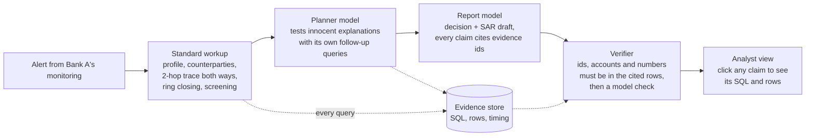

# Casefile

**An AML investigator that follows the money across banks, and can show you why.**

Casefile takes a transaction-monitoring alert, investigates it across two institutions' data through **Zetaris** (federated, governed, nothing copied), tests innocent explanations with **NVIDIA Nemotron**, and writes a suspicious-activity-report draft in which **every claim links to the exact query and rows behind it**. A verifier rejects any claim the evidence doesn't support before an analyst ever reads it.

Open Agent Hackathon 2026 · Track 2: *The Agent That Can Explain Why*

---

## Why this matters

Money laundering crosses bank boundaries on purpose. Each bank sees only its own side of a transfer, so a ring of payments that leaves Bank A, passes through Bank B and comes back looks harmless from inside either bank. The UN estimates 2 to 5% of global GDP is laundered every year ([AMLworld paper](https://arxiv.org/abs/2306.16424)).

AML analysts spend most of each alert stitching systems together, then write up a decision that a reviewer has to trust. Casefile does the stitching through one federated query layer, and makes the write-up checkable line by line.

## What happens to one alert



1. **Standard workup** (deterministic, same for every alert): customer record, who the account paid and was paid by, a time-ordered trace two hops out and two hops back across both banks, a "ring-closing" query that looks for payments linking where the money went to where it came from, watchlist screening, and typology signals (cycles, scatter-gather, interconnected counterparties, uniform amounts, pass-through, hubs).
2. **Investigation**: the planner model reads the workup and asks its own questions: is this a payroll account, a merchant, the customer's own accounts, a hub? It calls the same tools and cannot repeat a call.
3. **Decision and SAR draft**: ESCALATE or CLOSE, the typology, confidence, the evidence against, what would change the decision, a separate sanctions referral, and what could not be checked.
4. **Verifier**: every claim must cite evidence that exists in this case; every account id, date and number in a factual claim must appear in that evidence; then a model checks support. Rejected claims stay visible, struck through, so the reader sees what was caught.

## Where the data lives

| Data owner | What | Zetaris name | Local route | Cloud route |
| --- | --- | --- | --- | --- |
| Institution A (the analyst's bank) | Ledger | `inst_a.ledger_a` | Postgres `bank_a` | Postgres (Neon) |
| Institution A | Customer records, full | `inst_a.kyc_a` | Postgres `bank_a` | Postgres (Neon) |
| Institution B (partner bank) | Ledger | `inst_b.ledger_b` | Postgres `bank_b` | S3 Parquet |
| Institution B | Customer records **without names, birth dates, ID numbers** | `inst_b.kyc_b_shared` (local) / `shared.kyc_b` (cloud) | governed datasource view | governed SchemaStore view |
| Compliance | Synthetic watchlist | `compliance.watchlist` | Postgres `compliance` | S3 CSV |

**Governance is part of the answer.** Institution B shares customer records only through a view that drops PII, and the view runs inside B's database. Casefile never reads around it. When that stops a check (for example, B's customers can't be screened by name), the report says so under "What I could not check".

Transactions come from IBM's **AMLworld** (synthetic, with complete laundering labels, NeurIPS 2023). Customer records and the watchlist are generated. There are no real people anywhere.

## How the sponsor tech is used

| Sponsor | Where it does real work |
| --- | --- |
| **Zetaris** | The only path to data. Every tool sends Spark SQL that joins both banks' ledgers and customer records in one statement (for example `get_counterparties` joins 4 tables across 2 databases). Institution B's PII stays behind a datasource view. Every query is kept as evidence with its SQL and timing. |
| **NVIDIA Nemotron** | A different model per step: `plan` runs the investigation and writes the report, `verify` checks claims, `fast` is available for extraction. Calls go through NVIDIA's API or **Meterless** Nightshift (both OpenAI-compatible). Every call's model and latency is logged. |
| **Meterless** | Optional local router for Nemotron (`CASEFILE_LLM_PROVIDER=meterless`). |
| **Cursor** | Used to build. |

All agent SQL was also run through a real **Spark SQL 3.5** engine (`scripts/dev/check_spark_sql.py`) and produced identical results to the local DuckDB stand-in, so it runs unchanged on Zetaris Lightning.

## Results

> Measured on held-out labels. Filled in after the real AMLworld HI-Small run (Saturday).

| Run | Alerts | Accuracy | Precision | Recall | Typology hit | Sanctions referral | Claims rejected |
| --- | --- | --- | --- | --- | --- | --- | --- |
| Rules only, single bank | 30 | | | | | | |
| Rules only, federated | 30 | | | | | | |
| Casefile (Nemotron), federated | 30 | | | | | | |

The single-bank row is the same agent with Institution B's data hidden: what Bank A could conclude on its own.

---

## Setup, step by step

> **No Docker on your laptop, or only 8 GB of RAM?** Run everything in a free GitHub Codespace instead: **[docs/CODESPACE.md](docs/CODESPACE.md)** (10 numbered steps, all in the browser). The steps below are for running on your own machine.

You need Python 3.10 or newer. Every command runs from the `casefile` folder. Do the steps in order; each one ends with a check.

### Step 1. Install

```bash
python -m venv .venv
# Windows:  .venv\Scripts\activate
# Mac:      source .venv/bin/activate
pip install -r requirements.txt -r requirements-ui.txt
copy .env.example .env      # Mac: cp .env.example .env
```

**Check:** your prompt starts with `(.venv)`. Activate it again in every new terminal.

### Step 2. Try it on sample data (no keys, about 3 minutes)

```bash
python scripts/make_sample_data.py --out data/raw/sample
python scripts/prepare_data.py --trans data/raw/sample/SAMPLE_Trans.csv --patterns data/raw/sample/SAMPLE_Patterns.txt --accounts data/raw/sample/SAMPLE_accounts.csv
python scripts/check_setup.py --data
python scripts/investigate.py ALR-009 --rules
streamlit run app.py
```

**Check:** `check_setup` ends with "All checks passed", and the app opens in your browser. The sample data is crude, so its decisions mean little. It only proves the pipeline runs.

### Step 3. Get the real data (about 15 minutes)

1. Sign in to [Kaggle](https://www.kaggle.com) (free) and open [IBM Transactions for Anti Money Laundering](https://www.kaggle.com/datasets/ealtman2019/ibm-transactions-for-anti-money-laundering-aml).
2. Download only `HI-Small_Trans.csv`, `HI-Small_Patterns.txt` and, if listed, `HI-Small_accounts.csv` into `data/raw/`.
3. Close other heavy apps, then run (one line; drop `--accounts ...` if you have no accounts file):

```bash
python scripts/prepare_data.py --trans data/raw/HI-Small_Trans.csv --patterns data/raw/HI-Small_Patterns.txt --accounts data/raw/HI-Small_accounts.csv
python scripts/check_setup.py --data
```

**Check:** "All checks passed". This replaces the sample files and the alert queue. It caps itself at 2 GB of memory.

### Step 4. Connect Nemotron (about 5 minutes)

1. Create a key at [build.nvidia.com](https://build.nvidia.com/settings/api-keys).
2. Put it in `.env` as `NVIDIA_API_KEY=...`. Never paste it into a chat or commit it.
3. Run:

```bash
python scripts/check_setup.py --models   # which Nemotron models your key can call
python scripts/check_setup.py --model    # one reply
python scripts/investigate.py ALR-001    # a full model-driven case
```

**Check:** the case ends with a line like `=> ESCALATE (...) claims: 5 verified, 0 rejected`. If a model id isn't available, set `CASEFILE_MODEL_PLAN` / `CASEFILE_MODEL_VERIFY` in `.env` to ids from the list.

To route through **Meterless** instead: install Nightshift, add your NVIDIA key inside it, then set `CASEFILE_LLM_PROVIDER=meterless`, `METERLESS_BASE_URL` and `METERLESS_TOKEN` in `.env`.

### Step 5. Install Zetaris on your laptop (about 1 hour, mostly waiting)

Zetaris recommends giving Docker 8 GB of memory; its installer refuses to start below 6 GB. On an 8 GB laptop, give Docker **6 GB** and close everything else while it runs. Don't run Step 3 at the same time.

1. **Install Docker Desktop.** On Windows, enable WSL2 and run the Zetaris commands below from a WSL (Ubuntu) terminal.
2. **Give Docker 6 GB.**
   - Mac: Docker Desktop → Settings → Resources → Memory: 6 GB, CPUs: 4.
   - Windows: create `C:\Users\<you>\.wslconfig` containing the two lines `[wsl2]` and `memory=6GB`, then run `wsl --shutdown` and restart Docker Desktop.
3. **Get the bundle.** Sign in at [Zetaris Cloud](https://www.zetaris.com/cloud) (Start Free), open the [Run locally page](https://cloud.enterprise.zetaris.com/dashboard/download), download `zetaris-platform.zip` and note the registry sign-in command shown there.
4. **Unpack and sign in to the registry:**

```bash
unzip zetaris-platform.zip && cd zetaris-platform
docker login zetarishackathon.azurecr.io
./preflight.sh
```

5. **Edit the bundle's `.env`** (keep everything else as supplied). These values come from Zetaris's own small-machine guide:

| Setting | Value |
| --- | --- |
| `ZETARIS_ADMIN_EMAIL` | your email |
| `ZETARIS_ADMIN_PASSWORD` | 8+ chars with lower, upper, digit and one of `$ @ ! % * ? &` |
| `ZETARIS_ADMIN_ORG` | `casefile` |
| `ZSPARK_DRIVER_MEM` | `2g` |
| `ZSPARK_DRIVER_CORES` | `2` |
| `ZSPARK_MASTER_URL` | `local[2]` |
| `ZETARIS_API_MAX_HEAP` | `1g` |
| `UI_PORT` / `GUI_URL` / `ALLOWED_ORIGINS` | `3000` / `http://localhost:3000` / `http://localhost:3000` |

6. **Start it:**

```bash
docker compose pull
docker compose up -d
./verify.sh
```

**Check:** `verify.sh` passes its checks, and <http://localhost:3000> lets you sign in. In the SQL Editor, `SELECT 1 AS one;` returns 1. Stuck? Post your OS, the command and the error in Zetaris's HackOS Help desk, or see their [troubleshooting guide](https://zetaris.github.io/getting-started/docs/guides/troubleshooting.html).

### Step 6. Put the data where Zetaris federates over it

1. **Start the sources database** (one small Postgres, capped at 256 MB, with three databases: `bank_a`, `bank_b`, `compliance`):

```bash
docker compose -f infra/docker-compose.sources.yml up -d
python scripts/publish_local.py check
```

2. **Load the prepared data:**

```bash
python scripts/publish_local.py load --yes
```

3. **Register it in Zetaris.** Print the SQL, then paste and run it **one statement at a time** in the Zetaris SQL Editor. Type the password (`casefile-local` unless you changed it) where it says `<LOCAL_PG_PASSWORD>`:

```bash
python scripts/publish_local.py sql
```

4. **Point Casefile at Zetaris.** In `.env` set:

```
CASEFILE_DATA_BACKEND=zetaris
ZETARIS_ROUTE=proxy
ZETARIS_BASE_URL=http://localhost:3000
ZETARIS_ORG_ID=<the number under Management -> Organisation -> ID>
ZETARIS_USERNAME=<your admin email>
ZETARIS_PASSWORD=<your admin password>
CASEFILE_TABLE_KYC_B=inst_b.kyc_b_shared
```

5. **Run the gate:**

```bash
python scripts/check_setup.py
```

**Check:** five tables show row counts, and the federated query (A's ledger × B's ledger × B's governed view) returns rows. If parsing looks wrong, `python scripts/check_setup.py --raw` prints Zetaris's raw response.

### Step 7. Use it

```bash
streamlit run app.py
```

Pick an alert, press **Investigate**, watch the steps stream in, then open any claim to see its SQL and rows. The **Money flow** tab draws the pattern behind the decision; **SAR draft** downloads the report.

### Step 8. Measure it

```bash
python scripts/run_eval.py --rules --single-bank   # what Bank A alone could conclude
python scripts/run_eval.py --rules                 # federated, no model
python scripts/run_eval.py                         # the full agent
```

Each run prints a Markdown results table and saves `runs/eval/<name>/results.json`.

---

## Commands

| Command | What it does |
| --- | --- |
| `python scripts/check_setup.py [--data / --model / --models / --raw]` | Gate checks for data and models |
| `python scripts/investigate.py ALR-009 [--rules] [--steps N]` | One case end to end; writes `runs/cases/<id>.json`, `.report.json`, `.sar.md` |
| `python scripts/investigate.py --all --rules` | Every alert |
| `python scripts/run_eval.py [--rules] [--single-bank] [--limit N]` | Score against hidden labels |
| `streamlit run app.py` | The analyst view |
| `python scripts/publish_local.py check / load --yes / sql` | Local sources for Zetaris |
| `python scripts/publish_sources.py postgres / s3 / sql` | Cloud route (Neon + S3) |
| `pytest` | 19 tests, including a hand-built world with a known ring |

## Project layout

```
app.py                          Streamlit analyst view
casefile/
  config.py                     settings from .env
  llm.py                        one OpenAI-compatible client, model per step (NVIDIA or Meterless)
  evidence.py                   every query, model call and claim (runs/casefile.duckdb)
  ui_helpers.py                 money-flow graph for the app
  data/                         QueryResult, Zetaris HTTP backend, DuckDB stand-in, shared column layouts
  agent/
    tools.py                    the agent's tools: federated SQL, recorded as evidence
    analysis.py                 typology signals from the traced money graph
    workup.py                   the standard checks every alert gets
    investigator.py             planner loop (JSON actions, no repeats)
    report.py                   decision + SAR draft (model, or rules-only fallback)
    verifier.py                 deterministic + model claim checks
    pipeline.py                 one alert in, one verified case file out
    prompts.py, case.py, sqlutil.py, fx.py
scripts/                        data prep, setup checks, publishing, investigate, eval
scripts/zetaris/                registration SQL (local and cloud routes)
infra/                          the local sources container
tests/                          pytest
```

## How the evaluation stays honest

- The laundering flag never reaches a source the agent can read. It exists only in `eval/labels.csv`, which is read by `run_eval.py` after each case finishes.
- Alerts come from four simple monitoring rules (fan-out, fan-in, pass-through, currency churn), applied the same way to every account. Half the alerts are laundering accounts; half are "hard negatives" that trip the same rules.
- The transactions kept around each alert are chosen the same way for both kinds of alert, so data volume gives nothing away.
- Customer attributes and planted watchlist hits are random and label-blind. Some innocent customers have name-only watchlist matches, as in real screening.
- `prepare_data.py` is deterministic: the same inputs and `--seed` give identical files.

## Limitations

- Customer records and the watchlist are synthetic, so declared turnover and watchlist hits carry no laundering signal by design.
- Signals are tuned on AMLworld. Real banks have different payment mixes, and thresholds would need recalibration.
- Over Zetaris, an alert takes longer than on the local stand-in (Spark plans each federated query). Caching Institution B's ledger in Zetaris helps.

## Credits

IBM AMLworld data (Altman et al., NeurIPS 2023 Datasets and Benchmarks; Community Data License Agreement) · Zetaris [getting-started](https://github.com/zetaris/getting-started) guides · NVIDIA Nemotron · Meterless.
